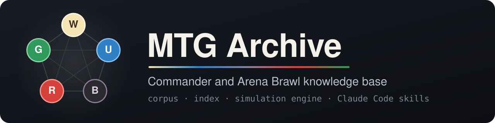
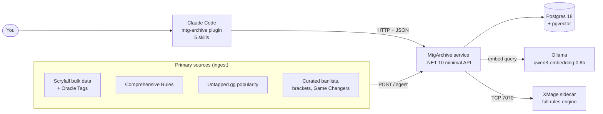
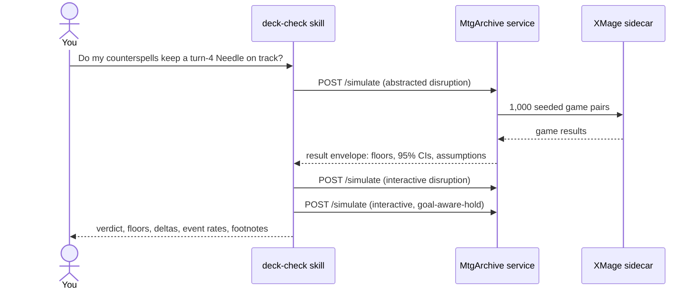

<p align="center">
  
</p>

<p align="center">
  <a href="../../actions/workflows/ci.yml"></a>
  
  
  
  <a href=".claude-plugin/marketplace.json"></a>
  <a href="LICENSE"></a>
</p>

<p align="center">
  <a href="#ask-it-anything">Skills</a> ·
  <a href="#quickstart">Quickstart</a> ·
  <a href="#architecture">Architecture</a> ·
  <a href="#contributing">Contributing</a>
</p>

MTG Archive answers Magic: The Gathering questions about **your** deck, from primary sources, with citations.

It is a self-hosted knowledge base for Commander and the three Arena Brawl formats. A .NET service holds the cards, the Comprehensive Rules, the banlists, and your collection in one Postgres database. An XMage sidecar plays thousands of seeded games to measure a deck. Five Claude Code skills turn a plain question into service calls, and every fact in the answer cites the call that gave it.

## Ask it anything

Install the plugin, then ask in your own words. You do not name the skill.

| Skill | Ask it | It answers with |
|---|---|---|
| **mtg-lookup** | "What stops activated abilities of a named card?" | Cards, rulings, rules, and legality, each with a fetchable footnote. |
| **deck-check** | "Which Arena Brawl queues can I take this deck to?" | Deck verdict per format, mana sources per color, bracket floor, and simulated consistency and resilience. |
| **build-deck** | "Build me a deck that drops Pithing Needle on turn 1, from my collection." | A legal list from cards you own, tuned in a loop against a numeric target. |
| **commander-swap** | "Golos got banned. What can lead this deck instead?" | Ranked commanders by how much of the 99 each one keeps, with each loss cited. |
| **archive-admin** | "Import my ManaBox collection and refresh the corpus." | Collection import, ingest runs, and corpus state. |

Each example below is a real run. The deck-check answers are word for word from the [acceptance records](eval/acceptance/), trimmed. The lookup and admin examples are live service calls.

<details>
<summary><b>deck-check</b> · "Do my counterspells keep a turn-4 Pithing Needle on track?"</summary>

> Here's my Obeka deck: eval/acceptance/done-query-2/final-99.json. It runs Mana Drain, Arcane Denial, Flusterstorm, Pact of Negation and An Offer You Can't Refuse. Against the usual counterspell-and-removal pressure, do my counterspells and protection actually keep a turn-4 Pithing Needle on track?

**No.** Your answers barely move the turn-4 Pithing Needle. With no disruption, the Needle is on the battlefield at the end of turn 4 in at least 67% of games. Under a turn-3 counterspell and turn-4 removal, that falls to at least 6.6% with your answers live. If the pilot holds up mana for answers, it reaches at least 13.3%.

| Run | Mode / policy | Baseline | Disrupted | Delta |
|---|---|---|---|---|
| Your answers ignored | abstracted / goal-aware-greedy | ≥ 67%, greedy policy (95% CI 64.0–69.8%) | ≥ 0.4%, greedy policy (0.2–1.0%) | 0.666 |
| Your answers live | interactive / goal-aware-greedy | same as above | ≥ 6.6%, greedy policy (5.2–8.3%) | 0.604 |
| If the pilot holds up answers | interactive / goal-aware-hold | ≥ 67.7%, greedy policy (64.7–70.5%) | ≥ 13.3%, greedy policy (11.3–15.5%) | 0.544 |

Each run: 1000 pairs, base seed 42, engine xmage-1.4.62V1+5e6c91b6, 0 engine errors.

**Why your answers do so little here.**
- **Pact of Negation never answers.** The response rule skips pacts.
- **Flusterstorm never answers.** The response rule skips counters that say "unless its controller pays", and the scripted opponent pays every such tax.
- **The counterspell usually finds you tapped out.** It is cast right after the Needle, and the hold reserve starts only after the goal holds.
- **The removal is where holding helps.** Its answered rate goes from 6.2% to 12.8%, which is most of the gain from 6.6% to 13.3%.

*The full answer also gives per-event rates, engine coverage, and every assumption line. [Full transcript](eval/acceptance/interactive-query-1/transcript.md).*

</details>

<details>
<summary><b>deck-check</b> · "Which Arena Brawl queues can I take this deck to?"</summary>

Treating "Arena Brawl queues" as all three Brawl formats, one call each.

- Brawl: illegal. Cut Demonic Tutor (banned)[^1] and add one legal card.
- Competitive Brawl: illegal. Old Stickfingers is banned as commander[^2]. Change the commander. The other 99 cards pass.
- Standard Brawl: illegal. The deck has 100 cards and the format allows 60[^3]. The commander and 66 of the 99 other cards are not legal[^4]. Rebuild the deck.

Versions: formats brawl, competitive_brawl, standard_brawl; Brawl legality as of 2026-10-05.

```text
[^1]: Demonic Tutor: "brawl banned as of 2026-10-05." GET /cards/82004860-e589-4e38-8d61-8c0210e4ea39
[^2]: Old Stickfingers: "competitivebrawl banned as of 2026-10-05." GET /cards/1d85eec2-80db-466c-bd48-d2a12866e8bd
[^3]: Rule 903.12. GET /rules/903.12
[^4]: Old Stickfingers: "standardbrawl not_legal as of 2026-10-05." GET /cards/1d85eec2-80db-466c-bd48-d2a12866e8bd
```

*[Run record](eval/acceptance/brawl-query-3-old-stickfingers-three-formats.md).*

</details>

<details>
<summary><b>build-deck</b> · "A competition-ready deck that consistently drops Pithing Needle on turn 1"</summary>

From the [acceptance record](eval/acceptance/done-query-2-turn-one-pithing-needle.md): the collection had 1,890 cards. The skill read "competition-ready" as bracket 4 and "consistently" as a target of 0.80. It stated an iteration budget of 15 and its stop rules before the first call.

It returned a legal 100-card Obeka list built only from owned cards. The best floor was 0.189 against the 0.80 target, and the answer said so plainly: a singleton turn-1 goal cannot reach 0.80. On the XMage engine, the same final list scores:

| Engine | Floor | 95% CI | Runs | Seed |
|---|---|---|---|---|
| xmage-1.4.61V1+09f8be52 | ≥ 19.5%, greedy policy | 18.77%–20.33% | 10,000 | 20260924 |

</details>

<details>
<summary><b>commander-swap</b> · "My Golos commander is banned. What else can lead this deck?"</summary>

From the [acceptance record](eval/acceptance/done-query-1-banned-commander.md): `POST /commander-alternatives` returned 20 five-color candidates, and each one keeps 99 of the 99 cards. The skill re-ranked the shortlist by function with semantic search (The First Sliver, Jodah, Esika). It presented five, each with its Oracle text and a footnote. `GET /ban-events/94` dates the Golos ban to 2021-09-13, with the announcement URL.

</details>

<details>
<summary><b>mtg-lookup</b> · semantic card search, live</summary>

```sh
curl -s -X POST http://127.0.0.1:8080/cards/semantic-search \
  -H 'content-type: application/json' \
  -d '{"query": "artifact that stops activated abilities of a named card", "format": "commander"}'
```

The top three hits:

| Card | Cost | Distance |
|---|---|---|
| Pithing Needle | {1} | 0.288 |
| Edifice of Authority | {3} | 0.319 |
| Sorcerous Spyglass | {2} | 0.340 |

Each hit carries its Oracle text, color identity, popularity rank, and legality for the requested format.

</details>

<details>
<summary><b>archive-admin</b> · corpus state, live</summary>

```sh
curl -s http://127.0.0.1:8080/corpus-state
```

```json
{
  "versions": { "banlist_version": "2026-02-09", "cr_effective_date": "2026-09-25" },
  "embedding_state": {
    "model_tag": "qwen3-embedding:0.6b",
    "dimensions": 1024,
    "prefix_set_version": "9D84B9513202418B"
  },
  "last_phase_runs": { "card_upsert": { "run_id": 7 }, "re_embed": { "run_id": 7 }, "…": "…" }
}
```

An ingest runs ten phases in order: `fetch_validate`, `card_upsert`, `source_profile_derive`, `card_feature_derive`, `cr_refresh`, `banlist_replay`, `legality_rebuild`, `popularity_load`, `bracket_load`, `re_embed`.

</details>

## Quickstart

You need Docker. A GPU is optional and speeds up the embedding step.

**1. Start the stack.**

```bash
docker compose up -d
```

For an NVIDIA GPU, add the overlay:

```bash
docker compose -f compose.yaml -f compose.gpu.yml up -d
```

The first start builds the XMage sidecar image and pulls the embedding model. That takes a while. The service is ready when `http://127.0.0.1:8080/healthz` returns `ok`.

**2. Load the corpus.**

```bash
curl -X POST http://127.0.0.1:8080/ingest
```

Poll `GET /ingest/runs/latest` until the status is `succeeded`. Or ask the archive-admin skill to do it.

**3. Install the plugin.** The repo is its own Claude Code plugin marketplace, so the plugin and the service always share one version.

```bash
claude plugin marketplace add /path/to/mtg-archive
```

```bash
claude plugin install mtg-archive@mtg-archive
```

The skills call `http://127.0.0.1:8080`. Set `MTG_ARCHIVE_URL` to use another address.

**4. Optional: import your collection.** Export it from ManaBox as CSV and ask archive-admin to import it. To call the service yourself, send `PUT /collection` a JSON body with `format` set to `manabox_csv` and the CSV text in `content`. build-deck then builds only from cards you own.

## Architecture



- **One store.** Postgres with pgvector holds the corpus, the index, the vectors, and your collection ([ADR 0001](docs/adr/0001-postgres-pgvector-single-store.md)).
- **No MCP layer.** The service speaks plain HTTP and JSON. The skills call it with `curl`. Legality filters at the service boundary, so card search returns only cards legal in the requested format.
- **A frozen embedding model.** The model and its query prefixes change only through the retrieval eval ([ADR 0007](docs/adr/0007-embedding-model-freeze.md)).
- **A real rules engine.** XMage plays every simulated game. The service sends it seeded games over TCP inside the compose network only ([ADR 0011](docs/adr/0011-xmage-simulation-engine.md)).
- **Answers stay skill-side.** The service returns facts and numbers. The skills choose, rank, and explain ([ADR 0006](docs/adr/0006-skill-side-recommendation-loop.md)).

### A deck question, end to end



### Simulation tiers

A skill uses the cheapest tier that answers the question.

| Tier | What it does | Runs on |
|---|---|---|
| 1 | Closed-form draw math: sources per color, pip demand, category draw probability | Service |
| 2 | Monte Carlo goldfish games against an idle opponent | XMage |
| 3 | Abstracted disruption: scheduled removal and counters, no response window | XMage |
| 4 | Interactive disruption: a scripted opponent casts real cards, and your deck can answer | XMage |

Every probability is a floor with a 95% interval, a run count, and a seed. The goal-aware pilot plays a greedy line and misses lines a stronger player can find, so the label calls it a floor ([ADR 0003](docs/adr/0003-goal-aware-greedy-pilot-floor-answers.md)).

### Formats

Commander and the three Brawl formats: Brawl, Competitive Brawl, and Standard Brawl ([ADR 0012](docs/adr/0012-arena-brawl-formats.md)). Each answer names the format it used. A deck verdict gives one status per format and cites each blocker.

### HTTP API

The service publishes its contract at `/openapi.json`. Conventions live in [docs/api-conventions.md](docs/api-conventions.md).

| Area | Routes |
|---|---|
| Cards | `GET /cards`, `GET /cards/{oracle_id}`, `POST /cards/search`, `POST /cards/semantic-search`, `POST /commander-alternatives` |
| Rules | `GET /rules/{number}`, `POST /rules/search` |
| Banlist | `GET /banlist/versions`, `GET /banlist/{version}`, `GET /ban-events/{id}` |
| Brackets | `POST /bracket-classification`, `GET /bracket-spec/…`, `GET /game-changers/…` |
| Decks | `POST /decklist-parse`, `POST /deck-verdict`, `POST /tier1-report`, `POST /simulate` |
| Collection | `PUT /collection`, `GET /collection` |
| Ingest | `POST /ingest`, `GET /ingest/runs/latest`, `GET /ingest/runs/{id}`, `GET /corpus-state` |

### Gates

| Gate | What it checks | Latest result |
|---|---|---|
| [CI](.github/workflows/ci.yml) | Format, build, the XMage image with its shim tests and determinism self-test, and the test suite on Testcontainers; the retrieval eval runs on demand | Every push and PR |
| [Retrieval eval](eval/retrieval/) | Card and rules search quality over curated queries; gates any model or document change | 2026-09-25: nDCG@10 0.538 overall, 0.781 rules; rules recall@30 0.923 |
| [Engine parity](eval/parity/report.md) | XMage tag, patch, and shim changes against the last engine, 10,000 games per engine per comparison | 2026-10-11: 36 of 36 pass |
| [Skill trigger eval](plugin/mtg-archive/evals/) | Each skill fires on its questions and only on its questions | Run on every skill description change |

## Contributing

Read [CLAUDE.md](CLAUDE.md) first. It holds the writing style, the workflow, and the gates, for humans and agents alike.

**Dev loop.** Run the database and the embedding model in Docker and the service on the host:

```bash
docker compose up postgres ollama
```

```bash
dotnet run --project src/MtgArchive
```

`/simulate` needs the XMage sidecar, and only the compose network reaches it. For simulation work, run the full stack with `docker compose up --build`.

**Tests.** The suite needs a running Docker daemon: Testcontainers starts Postgres and the sidecar. Run `/verify` in Claude Code before a PR. It builds the sidecar image, checks the format, builds, and runs the suite.

**Dev container.** `.devcontainer/` gives an isolated environment with the .NET SDK, a private Docker daemon, `gh`, and Claude Code. See [docs/dev-container.md](docs/dev-container.md).

**Where things live.**

```text
src/MtgArchive/         the service: cards, rules, banlist, bracket, collection, ingest, simulation
engine/xmage/           the XMage sidecar: patches, Java shim, protocol, self-tests
plugin/mtg-archive/     the Claude Code plugin: five skills, shared references, trigger evals
tests/                  the test suite
eval/                   retrieval eval, engine parity gate, acceptance records
data/                   curated banlists, bracket spec, Game Changers (popularity exports stay local)
docs/                   ADRs, API conventions, research notes
tools/                  EngineGate (the parity runner) and repo scripts
```

## License and notices

The code is under the [MIT License](LICENSE). [NOTICE](NOTICE) lists the third-party material: the XMage sidecar builds from [magefree/mage](https://github.com/magefree/mage) (MIT). The repo does not ship the Untapped.gg popularity exports. The maintainer keeps them on disk, and they keep their own terms. Card data comes from [Scryfall](https://scryfall.com) and the rules from Wizards of the Coast, both fetched at ingest.

MTG Archive is unofficial Fan Content permitted under the Fan Content Policy. Not approved/endorsed by Wizards. Portions of the materials used are property of Wizards of the Coast. ©Wizards of the Coast LLC.
